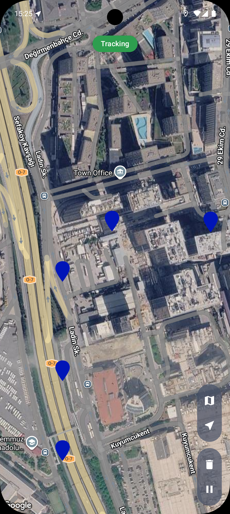
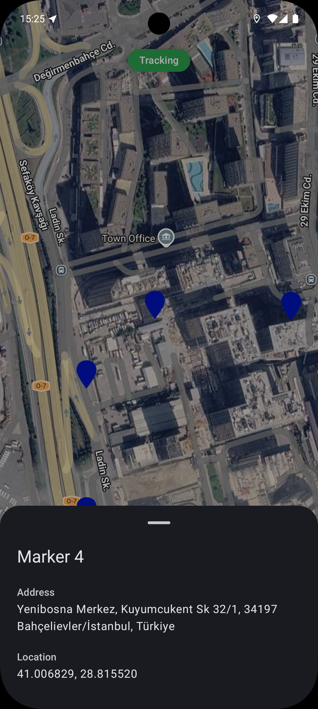
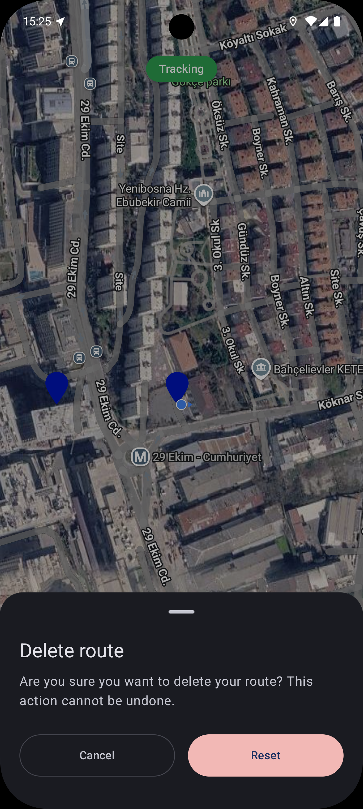

# MartiCase

Bu proje, Martı Technologies için hazırlanmış bir case çalışmasıdır.

Kullanıcının konumunu Google Harita üzerinde gösteren ve takip sırasında her 100 metrede bir marker bırakan Android uygulaması.

## Özellikler

- Kullanıcının konumunu haritada gösterir, açılışta konuma yakınlaşır
- Konum izni ve konum servisi kapalıysa ekranın üstünde uyarı kartı gösterir; karta dokununca uygulama içi izin / "konumu aç" diyaloğu açılır (izin kalıcı reddedilmişse ayarlara yönlendirir)
- Başlat / duraklat ile takip: takip sırasında her 100 m'de bir marker eklenir ve harita kullanıcıyı izler
- Takip foreground service ile çalışır, uygulama arka plandayken de sürer (bildirimden durdurulabilir)
- Sistem takibi sonlandırırsa (ör. uygulama süreci öldürülürse) servis yeniden başlatılmayı dener; yine de başlamazsa uygulama tekrar açıldığında takip kaldığı yerden devam eder
- Markerlar Room'da saklanır, uygulama kapanıp açılınca aynı yerlerinde kalır
- Markera dokununca başlık, adres (ters coğrafi kodlama) ve koordinatları gösteren bottom sheet açılır
- Rotayı silmeden önce onay bottom sheet'i
- Harita türü (normal / hybrid) DataStore'da saklanır

## Ekran görüntüleri

<table>
  <tr>
    <td align="center"><br>Takip ve markerlar</td>
    <td align="center"><br>Marker detayı</td>
    <td align="center"><br>Rotayı silme onayı</td>
  </tr>
</table>

## Kullanılan teknolojiler

| Alan | Kütüphane |
|---|---|
| UI | Jetpack Compose, Material 3 |
| Harita | Google Maps SDK, maps-compose |
| Konum | Fused Location Provider (Play Services) |
| DI | Koin |
| Asenkron | Kotlin Coroutines, Flow |
| Veritabanı | Room (KSP) |
| Ayarlar | Preferences DataStore |
| Loglama | Timber |

`minSdk 29`, `compileSdk / targetSdk 37`. Bağımlılık sürümleri `gradle/libs.versions.toml` içinde.

## Mimari

Clean Architecture, tek modül (`:app`):

```
com.zekibiyikli.marticase
├── di/            Koin modülleri
├── domain/        model, repository arayüzleri, use case'ler (Android bağımlılığı yok)
├── data/          Room, DataStore, konum ve Geocoder kaynakları, repository implementasyonları
├── presentation/  Compose ekranları, ViewModel, izin yardımcıları, tema
├── service/       LocationTrackingService, RouteTracker
└── util/
```

Takip akışı: `RouteTracker` (uygulama genelinde tek örnek) konum akışını dinler, 100 m kuralını uygular ve markerları Room'a yazar. `LocationTrackingService` onu foreground service olarak çalışır tutar. `MapViewModel` yalnızca `RouteTracker` ve Room'dan gelen durumu gözlemleyip ekranın tek bir `StateFlow`'unu oluşturur.

## Kurulum

Gereksinimler: Android Studio (AGP 9 destekli sürüm), JDK 17, Maps SDK for Android etkin bir Google Cloud API key'i.

1. Repoyu klonla ve Android Studio'da aç.
2. Proje kökündeki `local.properties` dosyasına key'ini ekle (bu dosya git'e girmez):

   ```
   MAPS_API_KEY=senin_api_key_in
   ```

   Key yoksa `local.defaults.properties` içindeki `DEFAULT_API_KEY` placeholder'ı kullanılır ve harita boş gelir.
3. Gerçek cihazda ya da Google Play destekli emülatörde çalıştır.

## Komutlar

```
./gradlew :app:assembleDebug        # derle
./gradlew :app:lintDebug            # lint
./gradlew :app:testDebugUnitTest    # birim testler
```

## Testler

Birim testler mesafe hesabını (`DistanceCalculatorTest`) ve `RouteTracker`'ın marker kuralını (`RouteTrackerTest`) kapsar. UI ve servis için otomatik test yok.